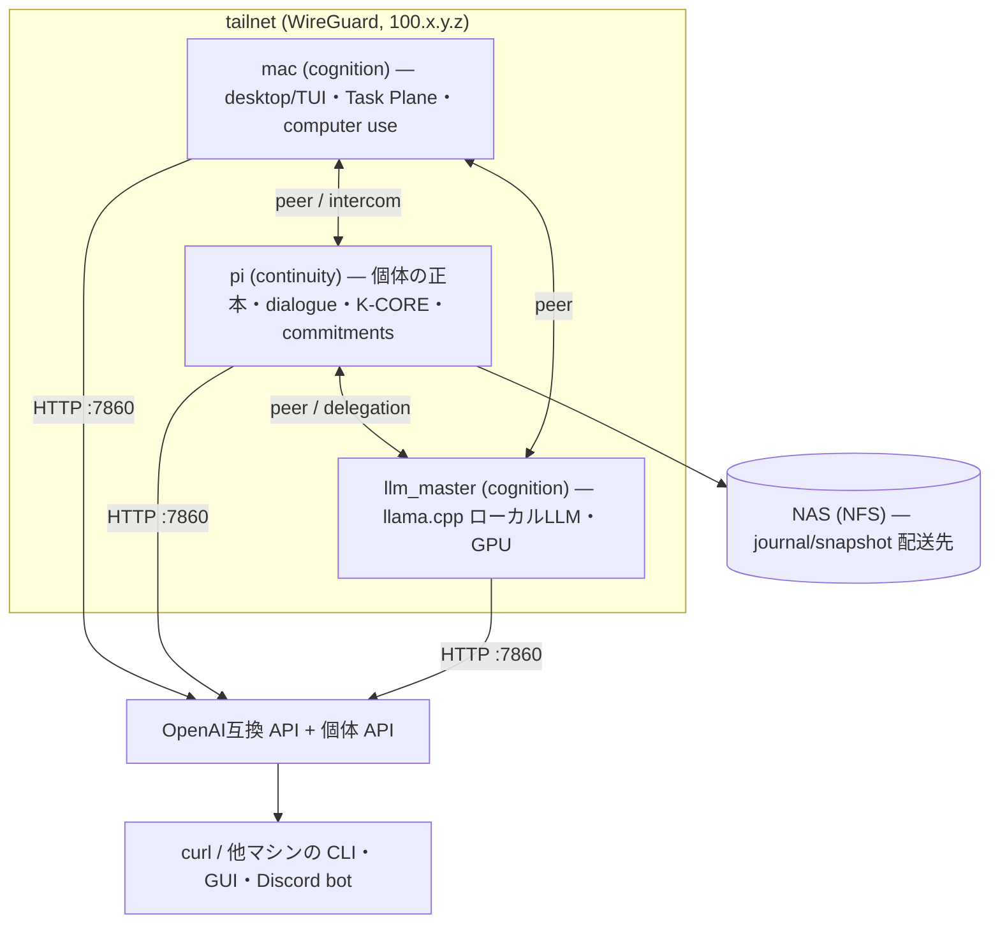

# 01 — 概要

対象: `README.md`, `spec.md`, `architecture.md`, `Cargo.toml`, `deploy/resident/README.md`

## Kamimusuhi とは

「長い system prompt を持つチャットボット」ではなく、**セッション・モデル・端末・推論基盤が
変わっても同じ個体として続く**人工認知個体を作る実験的アーキテクチャ。

> 知識は外にあってよい。計算も外にあってよい。強い推論さえ借りてよい。
> だが「誰が続いているのか」だけは外部サービス任せにしない。

個体（individual）は正本 SQLite（`kamimusuhi.sqlite`）に連続性系譜・証拠・記憶を持ち、
LLM は Persona Core / 認知資源として交換可能な「器官」として呼ばれる。
モデルの重みは個体を定義しない。

## 現在の姿（2026-11 時点）

実運用されている形態は、**tailnet（Tailscale）内の複数ノードに常駐する
`kamimusuhi-resident` 群 + その内1ノードが保持する個体** です。



- 各ノードは同一バイナリ `kamimusuhi`（`kamimusuhi-resident`）で動き、`node.role` で
  `continuity`（正本・24h）/ `cognition`（実行・GPU）を分ける。
- ノード間は HTTP + bearer token（`KAMIMUSUHI_NODE_TOKEN`）で繋がり、LAN と tailnet の
  複数アドレス（`alt_urls`）を自動で使い分ける。**外部サービスへの必須依存は無い**
  （任意で LLM プロバイダ tier と Cloudflare relay を足せる）。
- 個体は `continuity` ノードだけが持つ。`dialogue` 設定を持つ各ノードの個体は
  INV-006 により互いに**別個体（姉妹）**で、intercom で手紙をやり取りできる。

## 個体の正本と境界

```text
HTTP API (resident)
   │
   ├─ /v1/chat/completions ──→ Router ──→ tiers (local LLM / peer / provider)
   │
   ├─ /v1/kamimusuhi/talk ──→ kamimusuhi-runtime talk (1ターン1プロセス)
   │                              │
   │                        PersonaEnvelope ──→ Persona backend (LLM)
   │                              │
   │                        ProposalDraft ──→ Mutation Policy ──→ Continuity Kernel
   │                                                            │
   │                                                     kamimusuhi.sqlite (正本)
   │
   ├─ /v1/tools・/v1/tasks・/v1/agents・/v1/commitments…（運用面）
   └─ /task・/v1/intercom・/v1/library（ノード間面）
```

「考えた ≠ 言った ≠ 相手が確認した ≠ 実行した ≠ 成功した」を型で分け、
永続状態への書き込みは必ず typed proposal → policy gate → continuity kernel を通る。

## リポジトリ地図

| パス | 役割 |
|---|---|
| `crates/kamimusuhi-core` | 個体の契約: continuity/mutation/evidence/memory/persona/router 型。SQLite・HTTP 非依存 |
| `crates/kamimusuhi-store-sqlite` | 正本 SQLite（single-writer・migration・writer epoch） |
| `crates/kamimusuhi-runtime` | `kamimusuhi-runtime` CLI: init/inspect/demo-continuity/talk・turn pipeline・agent_exec（Task Plane 下側） |
| `crates/kamimusuhi-persona-http` | OpenAI 互換 Persona backend（typed envelope→chat 変換） |
| `crates/kamimusuhi-resource-http` | 認知資源 HTTP adapter（framing 上限・error 分類・TURN 相関） |
| `crates/kamimusuhi-resident` | `kamimusuhi` 常設デーモン+CLI: HTTP サーバ・router・probes・dialogue・intercom・delegation・tasks・commitments・MCP/tools |
| `crates/kamimusuhi-node` | ノード間 task wire 契約（型のみ、I/O 無し） |
| `crates/kamimusuhi-desktop` | eframe 製ネイティブ GUI（resident モード + local Jev 試験面） |
| `crates/kamimusuhi-tui` | `kami` 端末 UI（resident API クライアント） |
| `crates/kamimusuhi-testkit` | 決定的 fake・fixture server |
| `relay/` | Cloudflare Worker + DO の intercom メールボックス（到達不能時の任意 fallback） |
| `deploy/resident/` | 常設構成の install スクリプト・設定テンプレート・Discord bot・監視 |
| `docs/` | 生きている知識ベース（索引: `docs/README.md`） |
| `experiments/` | 仮説検証（MIOBA・器官候補 K0/H0/R0/S0/T0/O0 等） |
| `knowledge/` | 実験成果 catalog（`experiment-findings.json`） |

## 現状の達成範囲（実装済み / 設計段階）

実装済み（テスト・実機で検証されたもの）:

- continuity slice: writer fencing・atomic activation・restart 復元（v0.1, W0–W7）
- 常設 resident: OpenAI 互換 routing proxy・privacy/cost guard・対話 API・peer 転送
- 個体対話: subject 別履歴・tool calling・reference 注入・承認制 tool
- Task Plane: 外部 agent harness への委譲・実績 routing・評価バッテリー
- Commitment Engine: 再起動・失敗を跨ぐ耐久目標（checkpoint + 再計画ラダー）
- intercom: 姉妹個体間の envelope 配送（直接 + relay fallback・冪等）
- light/heavy 委譲: `POST /task` の型付きノード間タスク

設計段階（未実装）: Persona Core の学習、K-Nerve/常時背景認知、sleep/dream、音声、
episodic 想起の注入パイプライン（FIO 参照: [10-fio.md](./10-fio.md)）、
self domain の mutation、retention/deletion。

次: [02-quickstart.md](./02-quickstart.md) — 実際に立てて使う。
