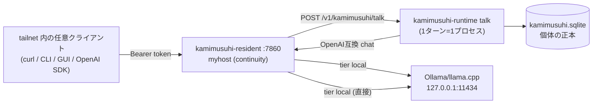

# 02 — クイックスタート: tailnet 内の1台に立てて API で使う

対象: `crates/kamimusuhi-resident/`（main.rs, config.rs, server.rs）,
`crates/kamimusuhi-runtime/`（main.rs）, `deploy/resident/*.example.json`

このページの目標: **Tailscale が入ったマシン1台に `kamimusuhi` を常駐させ、
tailnet 内のどのマシンからも HTTP API で個体と話せる状態**を最短で作る。
外部サービス・NAS・relay は一切不要（必要になった時だけ足す）。

## 前提

- Rust toolchain（`rust-toolchain.toml` にピン。`rustup` で自動取得）
- LLM の OpenAI 互換エンドポイントを1つ。tailnet 完結なら同じ台の
  llama.cpp / Ollama / LM Studio が手軽（例: `http://127.0.0.1:11434/v1`）。
  外部プロバイダも tier として後から足せる（[04](./04-resident.md)）。
- Tailscale が入っていて `tailscale ip -4` で `100.x.y.z` が取れること

## 1. ビルド

```bash
cargo build --release -p kamimusuhi-resident -p kamimusuhi-runtime
# バイナリ: target/release/kamimusuhi (resident+CLI), target/release/kamimusuhi-runtime
```

## 2. 個体を初期化する

個体の正本は `<root>/runtime/individual/` の SQLite。resident は個体を初期化**しない**
ので、最初に一度だけ `kamimusuhi-runtime init` を回す。

```bash
ROOT=/srv/kamimusuhi   # 任意の書き込み可能な場所
mkdir -p $ROOT/runtime/bin $ROOT/config
install -m 755 target/release/kamimusuhi $ROOT/runtime/bin/
install -m 755 target/release/kamimusuhi-runtime $ROOT/runtime/bin/

$ROOT/runtime/bin/kamimusuhi-runtime init --dir $ROOT/runtime/individual
```

次に persona（個体が喋る LLM backend）を登録する。`init` は persona を設定しないので、
**最初の `talk` に `--persona-*` を付けて1回呼ぶと runtime.json に永続化される**
（resident の `/v1/kamimusuhi/talk` はフラグを付けないので、この事前登録が必須）:

```bash
$ROOT/runtime/bin/kamimusuhi-runtime talk --dir $ROOT/runtime/individual \
  --persona openai-compatible \
  --persona-url http://127.0.0.1:11434/v1 \
  --persona-model llama3.2 \
  --persona-locality local-host \
  --privacy local-only \
  --message "動作確認"
```

`<dir>/runtime.json` を直接編集してもよい（tool を個体に見せる設定例は
`deploy/resident/runtime-reference.example.json`）。`--privacy` は既定 `local-only` —
`--persona-locality` が `local-host`/`local-network` なら通る。

## 3. resident.json を書く

`$ROOT/config/resident.json`（`deny_unknown_fields` — 綴り違いは `check-config` で弾ける）:

```json
{
  "node": { "id": "myhost", "role": "continuity", "listen": "0.0.0.0:7860" },
  "paths": { "root": "/srv/kamimusuhi" },
  "tiers": [
    {
      "name": "local",
      "base_url": "http://127.0.0.1:11434/v1",
      "model": "llama3.2",
      "billing": "local",
      "node_local": true
    }
  ],
  "dialogue": {
    "runtime_binary": "/srv/kamimusuhi/runtime/bin/kamimusuhi-runtime",
    "dir": "/srv/kamimusuhi/runtime/individual",
    "privacy": "local-only"
  }
}
```

- `role: continuity` は「このノードが個体の正本を持つ」の意味。単ノードではこれ。
- `dialogue` を付けたノードだけが `/v1/kamimusuhi/talk` を受け付ける。
- **tailnet だけに閉じたい**なら `"listen": "100.x.y.z:7860"`（tailscale IP）にすると
  LAN/WAN には一切開かない。`0.0.0.0` でも `/health`・`/capabilities` 以外は
  bearer token 必須なので実害は小さい。

## 4. 共有トークンを決めて起動

tailnet 内の全ノード・全クライアントで共有する bearer を1つ作る
（設定ファイルには**環境変数名**だけを書き、値は置かない設計）:

```bash
TOKEN=$(openssl rand -hex 32)
KAMIMUSUHI_NODE_TOKEN=$TOKEN kamimusuhi check-config --config $ROOT/config/resident.json
KAMIMUSUHI_NODE_TOKEN=$TOKEN kamimusuhi serve --config $ROOT/config/resident.json
```

常駐化は `deploy/resident/` の systemd unit / `install-node.sh` / mac 向け
`install-mac.sh`（LaunchAgent）を使う（[09](./09-operations.md)）。

## 5. API で使う

ノード上（loopback はトークン不要）:

```bash
curl http://127.0.0.1:7860/health
curl http://127.0.0.1:7860/v1/models
curl http://127.0.0.1:7860/v1/chat/completions \
  -d '{"model":"kamimusuhi","messages":[{"role":"user","content":"こんにちは"}]}'
```

tailnet の別マシンから（`Authorization` 必須）:

```bash
export KAMIMUSUHI_NODE_TOKEN=<同じトークン>
H=http://100.x.y.z:7860          # その台の tailscale IP or MagicDNS 名

# OpenAI 互換 proxy（ルータ経由で tier へ）
curl $H/v1/chat/completions -H "Authorization: Bearer $KAMIMUSUHI_NODE_TOKEN" \
  -d '{"model":"kamimusuhi","messages":[{"role":"user","content":"要約して"}]}'

# 個体と話す（記憶・連続性・tool つき。continuity ノードのみ）
curl $H/v1/kamimusuhi/talk -H "Authorization: Bearer $KAMIMUSUHI_NODE_TOKEN" \
  -d '{"subject":"eightman","message":"覚えてる？"}'
```

OpenAI 互換なので、既存の OpenAI クライアント/ライブラリは `base_url` と
`api_key` を差し替えるだけでそのまま使える。

## 6. CLI / GUI から使う

別マシンの `~/.config/kamimusuhi/` に:

```text
nodes       … 接続先 URL を1行ずつ（例: http://100.x.y.z:7860）
node_token  … 同じトークン（mode 600）
```

```bash
kamimusuhi chat                      # REPL。/status /approvals /quit
kamimusuhi status --url http://100.x.y.z:7860
kamimusuhi ask "テスト" --url http://100.x.y.z:7860
kami                                 # TUI（crates/kamimusuhi-tui）
./scripts/build-macos-app.sh --install   # macOS ネイティブ GUI
```

## 最小構成の動作イメージ



ここまでで「個体が住む tailnet 内ノード + API 面」が完成。
2台目以降の追加（認知ノード・peer 転送・intercom）は [06](./06-peers.md)、
運用・障害時挙動は [09](./09-operations.md)。
