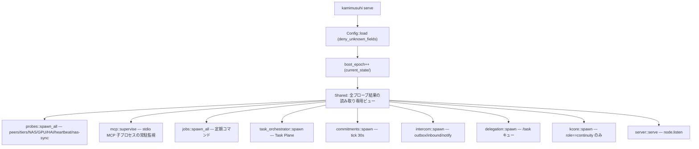

# 04 — Resident デーモンの内部

対象: `crates/kamimusuhi-resident/src/`（config.rs, state.rs, router.rs, probes.rs,
spool.rs, jobs.rs, usage.rs, status.rs, kcore.rs, selfmon.rs, mcp.rs, remote.rs）

`kamimusuhi-resident`（バイナリ名 `kamimusuhi`）は各マシンに常駐する
**ノードの胴体**。個体の正本は持たず（continuity ノードでも正本は
`kamimusuhi-runtime` が開く SQLite）、ネットワーク面・ルーティング・
定期ジョブ・ノード間プロトコルを受け持つ。

## 起動時の配線（`serve`）



`state.rs::Shared` は **I/O を行わない読み取り専用の内部ビュー** — probe スレッドが
書き、HTTP サーバと router が読む。永続化は `current_state/*.json`（atomic write）
と `logs/` への `append_sync`（fsync 付きジャーナル）の二系統。

## 設定スキーマ（`resident.json`）

`Config` は `deny_unknown_fields`。主要セクション:

| セクション | 内容 |
|---|---|
| `node` | `id`・`role`(continuity/cognition)・`listen`・`token_env`（既定 `KAMIMUSUHI_NODE_TOKEN`）・`capabilities` |
| `paths` | `root`（spool/・current_state/・cache/・runtime/ をぶら下げる）・`spool_warn_bytes`（既定 8GiB） |
| `nas` | 任意。`root`・`marker`（既定 `.kamimusuhi-nas`）・`probe_timeout_secs`。マーカーが無いと NAS 扱いしない |
| `peers[]` | `id`・`role`・`url`・`alt_urls`（LAN+tailnet 等、最後に応答した先を使う）・`capabilities`（未到達時の fallback 宣言）・`priority` |
| `tiers[]` | LLM backend（下表） |
| `routing` | lane 推定・latency ceiling・CostGuard 上限（下表） |
| `dialogue` | continuity ノードのみ。`runtime_binary`・`dir`・`privacy`・`timeout_secs`(600)・`max_concurrent`(2) |
| `intercom` | `enabled`・`max_hops`・`retry_secs`・`max_attempts`・`per_peer_daily_limit`(200)・`auto_reply_turns`・`relay{}`・`sisters{}` |
| `commitments` | `enabled`・`tick_secs`(30)・`max_active`・`same_failure_limit`(2)・予算・`notify_subject` |
| `task_plane` | `executors`/`executors_file`・`workspaces[]`・`max_concurrent`・`routing_mode`・`quota` |
| `delegation` | `workers`(2)・`max_attempts`(6)・`retry_secs`(15)・`poll_ms`(1500)・`default/max_timeout_ms`・`max_queue`(256) |
| `tool_judge` | `model`（既定 `hai`）・`on_unavailable`（既定 `approval`） |
| `kcore` | `binary`・`dir`・`interval_ms`(60s) — continuity ノードの監督 |
| `snapshot` | `database`・`interval_secs`(3600)・`spool_keep`(3) — `VACUUM INTO` を NAS へ |
| `libraries[]` | `name`・`path`・`description`・`source` |
| `mcp_servers[]` | `name`・`command`・`call_timeout_secs`・`judge_required[]`/`approval_required[]` 等 |
| `jobs[]` | 定期コマンド（例: obsidian-pull） |
| `intervals` | heartbeat/sync/peer/nas_probe/gpu の各周期 |
| `hai_account` | 残高監視（`low_balance_jpy` で status 警告） |

### tier（LLM 経路）のフィールド

`name`・`base_url`(`/v1` まで)・`model`・`auth_env`（値ではなく環境変数名）・
`timeout_secs`(180)・`probe_interval_secs`(20)・`condition`(always/small_request)・
`node_local`・`peer_local_only`（peer resident を呼ぶ時に `X-Kamimusuhi-Route: local` を付ける）・
`billing`(local/subscription/free_tier/metered)・`input/output_usd_per_mtok`（metered 必須、
未宣言なら起動時検証で拒否）・`privacy_ok_for_private_memory`（省略時は local/subscription
以外 fail-closed）・`context_limit_tokens`・`approx_tpm_limit`・`reasoning_suppression`・
`extra_body`・`strip_fields`・`prefer_lanes`。

## ルーティング（router.rs + runtime の RouteGate）

`POST /v1/chat/completions` は直接呼ばず RouteGate を通る。
判定順: **privacy → context/TPM → live health → billing class → latency**。

- **privacy**: persona/記憶を含む通常要求は private 既定（`routing.private_by_default`）。
  private を送ってよいのは `privacy_ok_for_private_memory=true` を明示した tier のみ。
- **lane**: ヒント `kamimusuhi_route_lane` が無ければ要求の形で推定 —
  最後が tool 結果 → `TOOL_TASK`、推定 16k tokens〜 → `MEMORY_HEAVY`、
  最後の発言が 200 字超 → `DEEP_REASONING`、他 → `FAST_CHAT`。
- **latency**: FAST_CHAT の ceiling は既定 4,000ms（`fast_chat_latency_ceiling_ms`）。
  実リクエストの全応答時間を EWMA に戻し、超え続ける経路は FAST_CHAT から外れる。
  未計測・15 分超の古い計測は同 band 内で先に試す（片方独占を防ぐ）。
- **billing**: `free_tier`（private 可なら）→ `local`/`subscription`（同一 zero-marginal band
  で実測 latency）→ `metered` は最後の fallback。`prefer_lanes` はその lane で
  billing より前に置く。
- **health**: probe の healthy/unhealthy + 実リクエスト失敗の即時反映 + 429 cooldown。
  known-down は healthy が無い時だけ試す。
- **CostGuard**（metered のみ送信前に適用）: 既定 `$0.02/request`・
  `$0.50/daemon session`・`$0.10/day`・`$2.00/month`。daily/monthly ledger は
  `current_state/routing-cost-ledger.json` で再起動を跨ぐ。
  **ローカル上限であって provider 請求額の保証ではない**。
- **model 指定**: `kamimusuhi`/`auto` = 自動、`<tier>` 名 or `<tier>/<model>` = 固定、
  `k0` or `X-Kamimusuhi-Route: local` = local tier のみ（LocalChat）。
  固定指定でも local-only/privacy/cost guard は迂回できない。
- peer resident を tier にするときは `peer_local_only: true` — 相手側の
  fallback を抑止し、fallback の所有は呼び出し側に残す。

## プローブ（probes.rs）

別スレッド群が `intervals` の周期で健全性を `Shared` へ書き込む。
NAS は **書き込みプローブ + マーカー確認**（未マウント時に SSD へ誤書きしない）。
heartbeat は存続証拠を journal へ。llm_master の GPU 状態・HAI 残高も
probe 経由で `/status` に載る。

## Spool → NAS（spool.rs）

書き込みは必ず **spool へ追記 → 別スレッドで NAS へ配送**（at-least-once、各行に一意 `id`）。
NAS 断・NFS ハングでも会話・heartbeat は止まらない。snapshot 等の丸ごとファイルは
tmp+rename、NAS 断中は `spool_keep` 個だけ保持。journal は `<category>/<node>/<date>.jsonl`
のノード別パスで 2 ノードが同じファイルへ追記しない（single writer 規則）。

## メトリクス（usage.rs）

`kamimusuhi_usage_*` の counter/gauge/histogram を `/metrics`（Prometheus）と
`/v1/usage`（JSON）で公開。履歴は `usage/history` が restart・NAS 配送を跨いで残る。
`cost_reports_total{kind,tier,model,outcome,cost_kind}` のように
**課金不明は `cost_kind=unknown` であって 0 円扱いしない**。

## K-CORE・selfmon・jobs

- `kcore.rs`: continuity ノードで `k-core` バイナリを `interval_ms`(既定60s) ごとに起動し、
  個体 runtime ディレクトリを監督する（再起動後も継続）。
- `jobs.rs`: `jobs[]` 設定の定期コマンド（例: Obsidian mirror の `git pull` —
  未コミット変更や分岐があれば失敗として status に出す）。
- `selfmon.rs`: resident 自身の劣化検知（status の自己評価）。
- `remote.rs`: desktop/TUI 向けの共有クライアント worker
  （Send/Decide/Task/Agents/Refresh → Connected/Reply/Status/Approvals/Tools/Tasks/Agents…）。

## ファイル配置（常設構成）

```text
/srv/kamimusuhi/
  runtime/bin/              kamimusuhi, kamimusuhi-runtime, k-core
  runtime/individual/       個体の正本（continuity ノードのみ）
  config/resident.json      構成（deploy/resident/local/<node>.resident.json 由来, git 管理外）
  config/secrets.env        mode 600, Git 管理外
  current_state/            state.json, boot_epoch, intercom.json, commitments.json,
                            tasks.json, approvals.json, routing-cost-ledger.json,
                            delegations.sqlite(WAL)
  cache/  spool/            NAS 未配送分
/mnt/kamimusuhi/            NAS（マーカー .kamimusuhi-nas がある時だけ）
  memory/ conversations/ logs/ artifacts/ experiments/ datasets/ models/ checkpoints/
```

次: [05-individual.md](./05-individual.md) — 個体側の仕組み。
