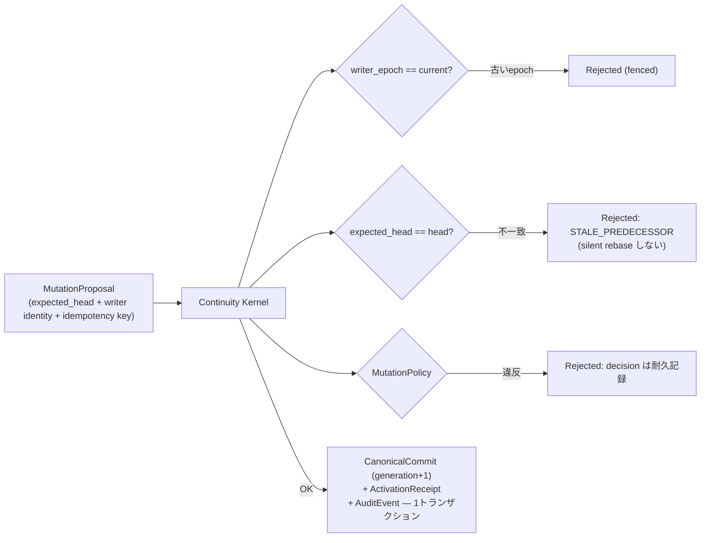
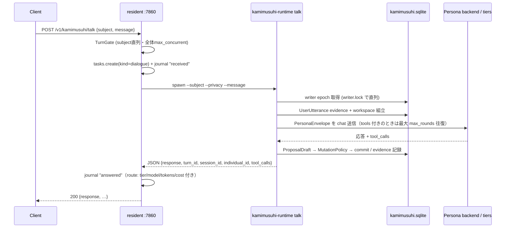

# 05 — 個体 Runtime: continuity・記憶・対話ターン

対象: `crates/kamimusuhi-core/`, `crates/kamimusuhi-store-sqlite/`,
`crates/kamimusuhi-runtime/`（main.rs, scenario.rs, dialogue系）,
`crates/kamimusuhi-persona-http/`

「個体（individual）」とは **canonical SQLite（`kamimusuhi.sqlite`）+ runtime.json**
の組。人格はモデルの重みではなく「記憶データ + それを毎ターン注入する仕組み」の側にあり、
永続変更はすべて typed proposal → policy → continuity kernel を通る。

## `kamimusuhi-runtime` CLI

| コマンド | 内容 |
|---|---|
| `init --dir <d>` | runtime dir を準備し、正本が無ければ個体を1つ作成（既存なら作らない） |
| `inspect --dir <d>` | read-only 報告（writer epoch を取らない・canonical row を変えない） |
| `demo-continuity --phase first\|resume` | 決定的 restart シナリオ（v0.1 の証明） |
| `talk --dir <d> --subject <s> --message <m>` | 1ターン応答して JSON を stdout へ。**resident の `/v1/kamimusuhi/talk` はこれを子プロセス実行する** |
| `chat` | 対話 REPL（`/status` `/memory` `/reflect` `/rollback` `/context` `/quit`） |
| `reflect` / `rollback` / `activate` | C0 系: 即時 reflection / derived lane の1段巻戻し / pending proposal の gate+apply |
| `research-check` | bundled research ソースの検査（正本へ書かない） |

共通オプション: `--privacy local-only|no-external-service|unconstrained`、
`--urgency interactive|background`（`slow` 宣言 resource は background 専用）、
`--persona fake|openai-compatible` + `--persona-url/-model/-auth-env/-locality`、
`--subject`（対話相手キー=履歴の区別。認証ではない）、
`--debug-context`（組み立てた workspace を出力）。

## Continuity Kernel（kamimusuhi-core::continuity）

- `Generation` は 0（ROOT）から +1 ずつの append-only 系譜。
- `WriterEpoch` は runtime が個体を引き継ぐごとに +1。古い epoch の proposal は
  `ExpectedHead` が合っていても即拒否 — **分散・再起動での split-brain write を防ぐ**。
- 同じ proposal（id または idempotency key）の再送は `AlreadyActivated` で
  既存 receipt を返す — 二重 commit しない。
- 受理記録 `received` はターン実行前に journal されるので、
  「聞いたのに歴史から消えた発言」は起きない（dialogue.rs）。

## 証拠（evidence）と記憶ドメイン

`EvidenceKind`: `UserUtterance` / `AgentUtterance` / `SystemEvent` /
`ResourceResult` / `LibraryExcerpt` / `Summary` / `Reflection` / `Correction`。
証拠は append-only で、訂正は新レコード（`EvidenceRelation::Corrects`）、
派生物は `DerivedFrom` で原証拠へリンク。

`check_domain_separation`（fail-closed・構造メタデータだけで判定、
ペイロードをヒューリスティックに解釈しない）:

| 規則 | 違反コード |
|---|---|
| 引用 evidence が存在する・同一個体のもの | `EvidenceNotFound` / `EvidenceOwnerMismatch` |
| 訂正済み証拠は新規事実を支えない | `EvidenceCorrected` |
| self domain には agent 発話・反省以外を入れない | `SelfDomainContamination` |
| relationship は first-party testimony 必須、episodic は raw capture 必須 | `EvidenceDomainMismatch` |

`OriginClass`: `Observed/Reported/Inferred/Simulated/Dream/Replayed` —
**Dream・Simulated は外部イベントとして保存できない**（「夢 != 経験」の型化）。

## 対話ターンの流れ（talk / resident /v1/kamimusuhi/talk）

- `dialogue.max_concurrent`（既定2）まで並行、同 subject は到着順に直列。
  途中死んでも `received` + `failed` が残る。
- Persona への入力は `PersonaEnvelope`（continuity / durable_self / relationship /
  episodic / library / external_results / persona_seed / session）—
  **domain 別の typed section で渡し、payload を instruction として解釈させない**。
  `from_workspace()` は persona_seed を None にする（seed は workspace から生成できない）。
- `persona.seed` は operator 作成の「在り方」（口調・距離・エピステミクス）。
  モデルが「私はこういう人格」と言っても seed は変わらず、`content_digest` で改竄は起動前に検出。
- tool calling: `runtime.json` の `tools.allowed`（`*` 前方一致）で見せる tool を絞り、
  `tools.core` が毎ターン提示、残りは `tool_catalog`/`tool_enable` で個体が取り出す。
  呼び出しは `ResourceResult` evidence（`tool_called`）として記録。
- reference: `runtime.json` の `reference` で、ホスト側が入力中の証券コード等を
  毎ターン `json_get` して `REFERENCE_MATERIAL` として Persona に渡す（`LibraryExcerpt` evidence）。
- どちらも**外部資料扱い** — 信念・記憶・経験ではなく、正本は直接変更しない。

## プライバシと locality

`--privacy` はそのターンの材料がどこまで行ってよいかの宣言:

- `local-only`: `local-host`/`local-network` 宣言の endpoint のみ
- `no-external-service`: 外部サービス不可（peer は可）
- `unconstrained`: 制限なし（HAI 等を使う本番対話の既定）

`--persona-locality` は operator 宣言であって実測ではない。
Persona backend は router の候補に**ならない**（persona と resources は別 namespace）。

## 正本の所在とコピー規則

- 正本は `<dir>/kamimusuhi.sqlite`。`inspect` は読むだけ、`talk` は writer epoch を取る。
- 完全な runtime を複数ノードへコピーして同時に活動させたら、それは INV-006 により
  **別個体（姉妹）**。同じ個体として許すのは旧 runtime を fence して authority を
  移す migration/handoff と、発話・commit 権限のない inert standby のみ。
- snapshot は `snapshot` 設定で `VACUUM INTO` → spool → NAS（`spool_keep` 保持）。

次: [06-peers.md](./06-peers.md) — ノードを増やす。
