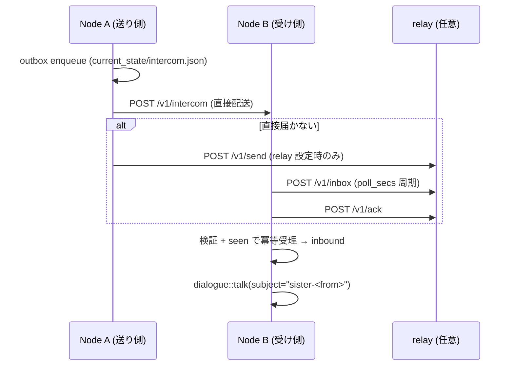

# 06 — 複数ノード: peers・委譲・intercom

対象: `crates/kamimusuhi-node/src/lib.rs`, `crates/kamimusuhi-resident/src/`
（delegation.rs, intercom.rs, remote.rs, probes.rs）, `relay/`,
`docs/light-heavy-node-architecture.md`, `docs/implementation/intercom.md`

Kamimusuhi の分散は「**個体を複製する**」のではなく「**ノードを増やして
器官・実行・出入口を足す**」。ノード間はすべて同一の HTTP API + bearer token で、
LAN と tailnet の複数アドレスを自動で使い分ける。

## peers の設定と到達性

```json
"peers": [
  {"id": "llm_master", "role": "cognition",
   "url": "http://192.168.x.y:7860",
   "alt_urls": ["http://100.x.y.z:7860"],
   "capabilities": ["llm.generate"], "priority": 100}
]
```

- health probe は `url` → `alt_urls` の順に試し、**最後に応答した先**を転送・library・
  tool 呼び出しに使う。LAN が切れても tailnet で継続できる（逆も同じ）。
- `capabilities` は未到達 peer への静的宣言（タスクを reject せず queue に置ける）。
  probe 成功後は peer の `/health` の宣言で上書きされる。
- `peer_healthy` が立たない peer への転送・tool 呼び出しは行わない
  （不通の接続は呼び出しを数分ブロックするだけ）。
- **信頼境界**: `KAMIMUSUHI_NODE_TOKEN` は fleet 共有の bearer。envelope の
  `from`/`to` は「申告」であって、トークンは送信者証明をしない — 同じトークンを
  持つノード同士の相互信頼モデル。

## Light / Heavy 委譲（`POST /task`）

`role: continuity` → `Light`（状態とスケジュール。イベントループをリモート作業で
塞がない）、それ以外 → `Heavy`（実行機。正本は持たない）。
wire 契約は `kamimusuhi-node` のみにあり、両向きが同じ型を話す。

```text
POST /task {"task_id?","type","requires":[],"payload","timeout_ms?","target_node?","wait_ms?"}
  → TaskRecord
GET /task/<id>        → 現在の TaskRecord
GET /capabilities     → {"node_id","role","mode","capabilities"}（無認証、/health 同値）
GET/POST /v1/delegations → list / show / retry / cancel
```

- `task_id` は冪等キー: 再送は既存レコードを返す（再試行が安全な理由）。
- `target_node` を名指しすると受信側は local 実行、別ノード名なら 409 —
  **委譲ループを防ぐ**。`wait_ms` は long-poll。
- 状態: light 側 `queued→delegating→running_remote→completed|failed|timeout`、
  `retry_pending→delegating` で回復。heavy 側 `queued→running→…`。
  in_flight は再起動で信用されず `retry_pending` に倒れ、冪等再送で整合。
- キューは `current_state/delegations.sqlite`（WAL）。payload/result は node-local のみ —
  journal/metrics に載るのは id・type・state・latency だけ（private 内容を外に出さない）。
- 分類は rule-based `delegation::decide`: `node.*`/`state.*` は常に local。
  `requires` と advertised capability で宛先を決めるので、将来の GPU/V100/cloud API
  ノードも **capability を advertise するだけで同一プロトコルに載る**。
- 既定の境界: workers 2・max_attempts 6・retry 15s・poll 1500ms・
  timeout 120s（上限 900s）・max_queue 256・HTTP timeout 10s。

型と capability: `node.ping`/`state.read`/`llm.generate` が実装済み。
`embedding`/`vision`/`web.research`/`plan.deep`/`agent.delegate`/`library.read`/
`dialogue.turn` は将来 executor 用に予約済み。

## Intercom（姉妹個体どうしの会話）

各ノードの `dialogue` に住む個体は互いに**別個体（姉妹）**。intercom は
その間で envelope（手紙）を運ぶ郵便。集約点はどこにも無い。



- **受信は個体の通常 intake を通る** — memory gate・writer epoch・タスクボードを
  迂回しない。subject は `sister-<from>`、発言者は姉妹個体と明記される
  （peer の言葉が self の記録と混ざらない）。
- **返信は個体の能動行為**（`peer_say` tool）。例外は operator が
  `intercom open <peer> <turns>` で開いた会話の自動返信のみ — `auto_left` が
  envelope と共に減り、`max_hops` が無人連鎖の絶対上限。個体は `[end]` 行で閉じられる。
- 重複は `seen` id で排除 — 直接配送と relay 経由の二重到着は無害。
  `accepted:false` は恒久拒否（hop 超過・宛先違い・個体不在）で dead-letter。
- `per_peer_daily_limit`（既定200/日）が送信量を上限化（tool でも operator でも同じ枠）。
- `sisters` マップは姉妹の表示名（例: 長女=mac・次女=pi・三女=llm_master）。
  キーは `peers` の id でなければならない（validate で検査）。

envelope: `id`（dedup キー）・`from`/`to`・`conversation`・`in_reply_to`・`hop`・
`kind`(message|close)・`body`(32KiB 上限)・`sent_at`・`auto_left`・`auto`・`retried`。

## Relay（任意の fallback）

`relay/` は Cloudflare Worker + Durable Object のメールボックス — **直接到達できない
向きの中継**。tailnet/LAN が張れていれば不要で、既定は無し。

```
POST /v1/send  {"to":"<node>","envelope":{…}} → {"seq":n}   (envelope.id で冪等)
POST /v1/inbox {"node":"<node>","after":n,"limit":m} → {"messages":[…]}
POST /v1/ack   {"node":"<node>","upto":n} → {"ok":true}
GET  /health
```

- 受信者ノードごとに DO が1つ。ack で削除、TTL 7 日、512 件上限。
- 共有トークン `RELAY_TOKEN`（worker）/ `KAMIMUSUHI_RELAY_TOKEN`（resident の `relay.token_env`）。
- **内容は E2E 暗号化されない** — Cloudflare に素通しで良い会話だけを流す。
- resident 側は `relay_cursor` を `current_state/intercom.json` に保持し、
  ポーリング再開位置を再起動で失わない。
- crash で ingest 後 ack 前に死んでも再配信されるだけ（受信側が dedup）。

## どこまで「tailnet で完結」するか

| 要素 | tailnet 完結 | 備考 |
|---|---|---|
| resident 間 HTTP・委譲・library・tool 転送 | ✅ | peers の url/alt_urls に tailnet IP |
| intercom 直接配送 | ✅ | relay 無しで成立 |
| intercom relay | ❌ Cloudflare | 片方向が開かない時だけの任意 fallback |
| LLM tier | 任意 | local llama.cpp だけでも動く。外部 tier は追加オプション |
| 監視・metrics | ✅ | /metrics は tailnet 内から scrape 可 |

次: [07-tasks-tools.md](./07-tasks-tools.md) — 個体に任せる仕事と道具。
