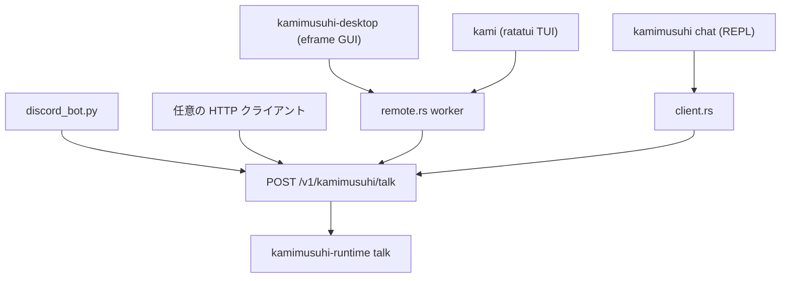

# 08 — 接続面（surfaces）: 人が個体に触る入口

対象: `crates/kamimusuhi-desktop/`, `crates/kamimusuhi-tui/`,
`crates/kamimusuhi-resident/src/remote.rs`, `crates/kamimusuhi-resident/src/client.rs`,
`deploy/resident/discord_bot.py`, `scripts/run-desktop.sh`, `scripts/build-macos-app.sh`

どの面から話しても、個体の正本は1つ（continuity ノードの SQLite）。
面はすべて resident の HTTP API へ繋ぎ、**subject（話し手キー）だけが違う**。
同じ subject なら面を跨いでも関係記憶・履歴は続く。

## 接続面の共通配線



- URL 解決: `--url` > `$KAMIMUSUHI_URL` > `~/.config/kamimusuhi/nodes`（1行1URL、順に試す）。
- token: `$KAMIMUSUHI_NODE_TOKEN` > `~/.config/kamimusuhi/node_token`。
- subject: `--subject` > `$USER` > `local-user`。履歴の区別であって認証ではない。

## デスクトップ GUI（kamimusuhi-desktop）

eframe 製ネイブGUI（Webサーバ不使用）。**既定は resident モード** — 常設個体と話す:

```bash
cargo run --release -p kamimusuhi-desktop              # resident モード
./scripts/build-macos-app.sh --install                  # target/macos/Kamimusuhi.app → ~/Applications
```

`~/.config/kamimusuhi/nodes` と `node_token` を読むので Finder 起動でも同じ接続先。
`--view chat|tasks|approvals|status|tools` で初期タブ指定。
`task_panel.rs` に「外部エージェント」タブ（executor 状態・タスク一覧/詳細・
取消・採否・継続・台帳・実績表）。

`--local` は Jev 試験面（worker.rs が local runtime を保持）:

```bash
./scripts/run-desktop.sh --privacy unconstrained --dir .local/desktop
```

発話前に Jev batch で可否・記憶関連性・不足情報を判定し、有効・privacy許可の
全器官を race 開始 → 最初の有効完了と同着候補を匿名（`candidate-N`）で品質判定 →
ACCEPT なら遅い器官を待たず返す。Jev 応答不能時は rule-based gate へ degrade
（障害 code は trace へ）。詳細: `docs/native-dialogue-gui.md`。

## TUI（kami）

ratatui 製端末 UI（UI がネットワークでブロックしない worker 構成）。

```bash
cargo install --path crates/kamimusuhi-tui   # または cargo run -p kamimusuhi-tui
kami --url http://100.x.y.z:7860 --view chat
./run_kamimusuhi_tui.command                  # macOS ダブルクリック用
```

View: F1 対話 / F2 タスク / F3 承認 / F4 状態 / F5 ツール（Tab/Shift-Tab で巡回）。
`agents.rs` に Task Plane パネル。

## CLI（kamimusuhi）

```bash
kamimusuhi chat                     # REPL: /status /approvals /quit
kamimusuhi ask "テスト"             # 実際にルーティングして応答+経路を表示
kamimusuhi status [--json]          # 0=正常 1=劣化 2=不達
kamimusuhi approvals / approve <id> / reject <id>
kamimusuhi library / agents / commit / intercom / say / node / task …
```

全サブコマンドは [03-api-reference.md](./03-api-reference.md) の対応表を参照。

## Discord bot（deploy/resident/discord_bot.py）

**operator-only gateway** — resident が個体状態を全部持ち、bot は面に徹する。

- 許可した guild/channel/user のみ（env: `DISCORD_BOT_TOKEN`・`DISCORD_GUILD_ID`・
  `DISCORD_ALLOWED_USER_IDS`・`DISCORD_ALLOWED_CHANNEL_IDS`）。
- `DISCORD_OPERATOR_SUBJECT` を設定すると、許可ユーザーがちょうど1人の場合に限り
  operator の subject（desktop と同じ履歴）で話せる — **複数人で subject を共有すると
  記憶が混ざるので禁止**。
- subject は `guild:channel:user` から安定生成（面・相手ごとに履歴が分かれる）。
- FIFO キューから subject ごと順番を守って最大 `dialogue.max_concurrent` 件並行で
  `/v1/kamimusuhi/talk` へ渡し、元メッセージへ返信。
- systemd unit: `kamimusuhi-discord.service`・依存: `discord-requirements.txt`。

## 面ごとの記憶の見え方

| 面 | 既定 subject | 効果 |
|---|---|---|
| `kamimusuhi chat` | `$USER` | 他面と共有しない限り分離 |
| desktop / kami | `$USER`（または `--subject`） | 同上 |
| discord | `guild:channel:user`（operator は共通化可） | 面を跨ぐ共有は operator のみ |
| intercom | `sister-<peer>` | 姉妹個体との専用履歴 |
| 承認通知等 | `notify_subject`（設定） | 個体の「体験」として intake |

次: [09-operations.md](./09-operations.md) — 常設構成と障害時挙動。
